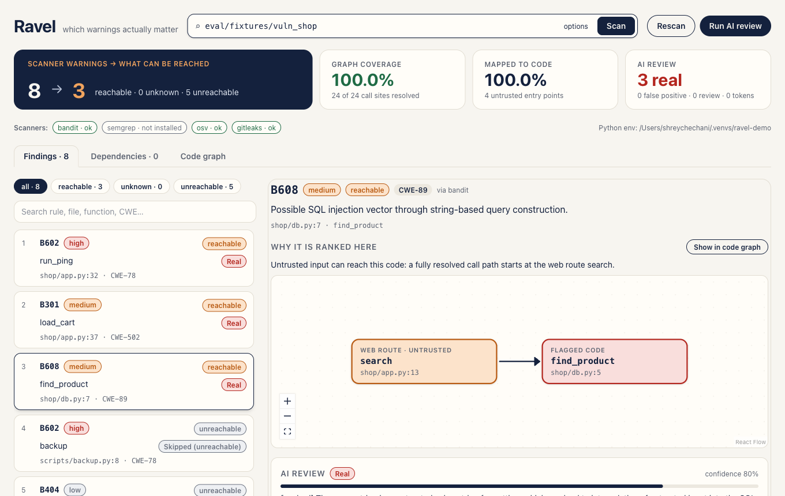
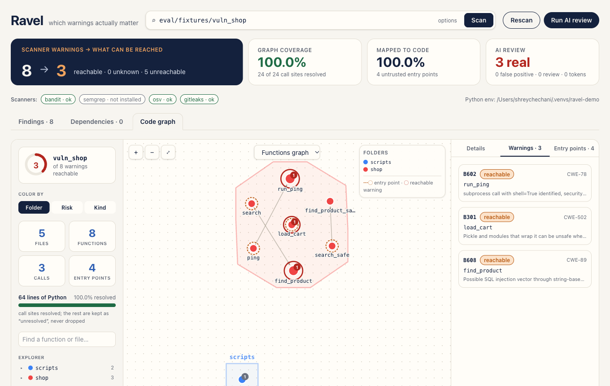
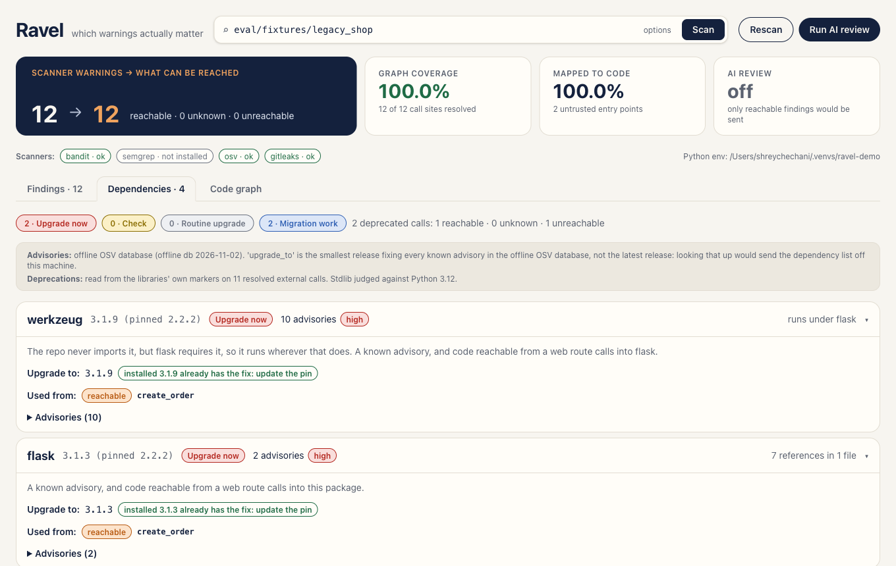
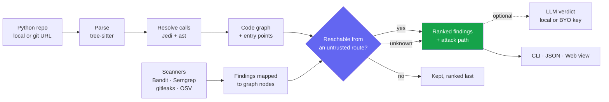

# Ravel

**Which security warnings actually matter? Ravel traces every scanner finding
back to your app's front doors, and keeps only the ones an attacker can reach.**

[](https://github.com/shreychechani/Ravel/actions/workflows/ci.yml)




---

## Why

Point a security scanner at a mid-size Python repo and you get a wall of
warnings, often a couple of hundred. Only a handful are real. The rest sit in
test files, offline scripts or dead code that no request ever touches. Teams
read the first thirty, hit noise, and stop reading the report.

The scanners aren't the problem. They read **one file at a time** and have no
model of how the system connects. Ravel builds that model first: a call graph
of the whole codebase. Then it asks one question of every finding: **can
untrusted input actually get here?**

## Results

Measured on labelled repos, pooled. Precision is always reported next to recall.

| Method | Warnings kept | Real bugs among them | Precision | Real bugs kept |
|---|---:|---:|---:|---:|
| Raw scanner output | 60 | 7 | 11.7% | 100% |
| Keep high/medium severity only | 16 | 6 | 37.5% | 100% |
| Keep the same number at random | 7 | 2.2 | 32.0% | 39.9% |
| **Ravel (reachability)** | **7** | **7** | **100%** | **100%** |

**8.57× the precision of raw scanner output, with no real vulnerability
dropped.** The target set before building was ≥ 3× while keeping ≥ 85%.

The call graph underneath was checked on its own before anything was built on
it:

- **42 / 42** hand-checked call edges correct.
- **98.3%** precision on the published PyCG call-graph benchmark.
- **89.7%** of calls seen at runtime recovered statically.

Every number is reproducible with one command. The full write-up, including
what these numbers *don't* prove yet, is in
[`docs/BENCHMARK.md`](docs/BENCHMARK.md).

> **An honest negative result.** An LLM triage layer was built on top. With a
> small local model, it marked a real SQL injection as safe. It added no
> precision and cost recall, so it ships **off by default**. The core of
> Ravel is deterministic graph analysis, not the LLM.

---

## What it does

**1. Ranks security findings by reachability.** Ravel runs Bandit, Semgrep,
gitleaks and OSV-Scanner, and maps every finding to a function in the graph.
It then traces back to Flask, FastAPI and Django routes. Each finding is
labelled **reachable** (with the exact path), **unreachable**, or **unknown**.
Nothing is hidden: unreachable findings stay in the report, just ranked lower.

**2. Draws the codebase.** An interactive graph of files and functions shows
the entry points and the warnings that can be reached. Click any function to
see who calls it and what it calls.



**3. Answers "what would upgrading cost?"** For each dependency, Ravel shows
its known advisories and the smallest release that fixes them. It also finds
**deprecated APIs** your code calls. It has no list of its own: it reads each
library's own `@deprecated` markers and `DeprecationWarning`s. The same
reachability tracing ranks each one as *upgrade now*, *routine*, or
*migration work*.



**4. Re-scans incrementally.** `ravel scan --since <git ref>` re-analyses only
the functions that changed. It compares content hashes, detects renamed
functions, and invalidates only the paths those changes touch.

---

## How it works



A few design rules hold throughout:

- **Never drop what you can't resolve.** If a call can't be resolved, its edge
  is marked `unknown` and kept, never dropped. Silently treating it as "no
  call" would hide real vulnerabilities.
- **Show how much of the map is real.** Graph coverage (the share of call sites
  resolved) is printed on every run. The numbers are only as good as the map.
- **No custom detection rules.** Ravel wraps mature scanners and adds the layer
  above them. It doesn't invent detections of its own.
- **Local-first and read-only.** Scanned code is parsed, never executed. Ravel
  never writes to the repo and never phones home. The only network steps are
  the ones you ask for: cloning a URL and updating the advisory database.
- **Cache by content.** Cache keys are content hashes, so results survive code
  moving around and refresh when the code changes.

---

## Quick start

Requires Python 3.12+, [uv](https://docs.astral.sh/uv/) and Node 20+ (for the
web view).

```bash
git clone https://github.com/shreychechani/Ravel.git && cd Ravel
uv sync

# Scan a bundled demo app: 8 warnings → 3 reachable
uv run ravel scan eval/fixtures/vuln_shop

# Scan any GitHub repo (optionally pinned to a commit)
uv run ravel scan https://github.com/owner/repo --ref <commit>

# Dependency + deprecated-API report
uv run ravel deps eval/fixtures/legacy_shop

# Web view on http://127.0.0.1:8765
npm --prefix web install && npm --prefix web run build
uv run ravel serve eval/fixtures/vuln_shop

# Reproduce the benchmark
uv run python -m eval.run
```

**Tips**

- Pass `--venv <the repo's virtualenv>` so calls into third-party libraries
  resolve. Coverage is printed on every run.
- Optional scanners are reported as *not installed* rather than silently
  skipped. Install them with `brew install gitleaks osv-scanner`, then run
  `uv run ravel osv-db update` to fetch the offline advisory database.
- **AI review** is optional. Use `--llm-provider ollama --model llama3.2:3b`
  for a fully local model, or `--llm-provider openai` with your own key. Only
  findings that pass the reachability filter are sent to it, never the raw
  scanner output.

A five-minute guided demo is in [`docs/DEMO.md`](docs/DEMO.md).

---

## Tech stack

| Layer | Choice |
|---|---|
| Parsing | tree-sitter |
| Call resolution | Jedi + Python `ast` |
| Graph | NetworkX |
| Scanners | Bandit · Semgrep OSS · gitleaks · OSV-Scanner (offline DB) |
| LLM (optional) | Ollama or any OpenAI-compatible API; verdicts cached by content hash, token budget capped |
| API | FastAPI (localhost only) |
| Web view | Next.js · Tailwind · React Flow · dagre |
| Tooling | uv · ruff · mypy · pytest · GitHub Actions |

## Repository layout

```
ravel/
  ingest/       file discovery, git URL cloning
  graph/        parsing, call resolution, imports, entry points, env discovery
  scanners/     Bandit · Semgrep · OSV-Scanner · gitleaks wrappers + normalization
  triage/       reachability, ranking, context assembly, LLM providers, verdict cache
  deps/         dependency report, deprecated-API detection
  incremental/  git diff, AST diffing, rename detection, path invalidation
  summarize/    bottom-up code summaries
  api/          ravel serve
  cli/          ravel scan · deps · serve · summarize · index · osv-db
web/            Next.js web view
eval/           benchmark harness, fixtures, ground truth, graph checks
docs/           benchmark, demo, roadmap, build plan
```

## Scope and limits

- **Python only** for v1. The architecture is language-agnostic, but going
  deep in one language is what makes the reachability answer trustworthy.
- **Entry points are HTTP routes** (Flask, FastAPI, Django). Code reached only
  from CLI scripts or task queues shows as unreachable.
- **Small benchmark.** Two labelled repos so far, and the labels still need an
  independent re-check. Details and next steps are in
  [`docs/BENCHMARK.md`](docs/BENCHMARK.md).

## Documentation

- [`docs/BENCHMARK.md`](docs/BENCHMARK.md): results, how to reproduce them,
  and open caveats.
- [`docs/DEMO.md`](docs/DEMO.md): five-minute demo runbook.
- [`docs/ROADMAP.md`](docs/ROADMAP.md): plain-English tour of the project and
  ideas for after v1.
- [`PRODUCT.md`](PRODUCT.md): product spec, data model and non-negotiables.
- [`docs/BUILD-PLAN.md`](docs/BUILD-PLAN.md): the phased, checkpoint-gated
  build plan.
- [`AGENTS.md`](AGENTS.md): rules for AI coding agents contributing to the
  repo.

## License

[MIT](LICENSE)

## Acknowledgements

Some domain knowledge (framework route patterns, OSV severity bands and
fixed-version extraction, file-type skip lists) was ported to Python from
[Arcflow](https://github.com/Veloce-AI/Arcflow) and
[CodeClean](https://github.com/Veloce-AI/CodeClean) by Veloce-AI, with the
owners' approval.
